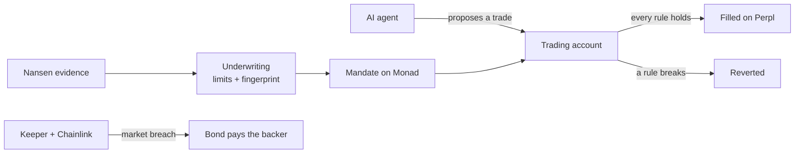

# Mandate

**AI traders that can't break your rules.**

Mandate is a risk-enforcement layer for AI trading agents on Monad. Nansen's smart-money data sets an agent's limits.
The chain checks those limits inside every trade the agent makes. And when the market breaks a limit on its own, the
operator's bond pays the backer back.

[**Live app**](https://mandate-rose.vercel.app) &nbsp;·&nbsp; [**Demo video**](https://youtu.be/cfVk2hWKUEA) &nbsp;·&nbsp;
[Design notes](docs/design.md) &nbsp;·&nbsp; [Specification](docs/PRD.md)

[](https://youtu.be/cfVk2hWKUEA)

---

## The idea

Handing capital to an AI agent means trusting it to respect limits it could simply ignore. Dashboards and alerts only
tell you after the damage is done.

Mandate moves the limits somewhere the agent cannot reach. The agent trades through an account that tests every order
against its rules in the same transaction. A trade that breaks one never happens.

The limits themselves are not guesses. They are compiled from Nansen evidence, and the report behind them is
fingerprinted and stored on-chain with the mandate, so anyone can check where every number came from.

> Nansen's data doesn't inform a person here. It becomes limits a smart contract enforces.

## How it works

**1. Nansen sets the limits.** Choose the markets an agent may trade. Mandate reads smart-money flows and perp
positioning from Nansen, settles a regime for each market, and turns it into hard numbers: leverage, position size,
order rate, a cooldown after losses, a drawdown floor. Every limit names the signal that produced it.

**2. The backer approves, and the fingerprint goes on-chain.** The backer signs in with a passkey — no seed phrase, no
extension. A trading account is created, the rules are written to Monad, and the report's fingerprint is stored beside
them. Anyone can recompute it in the browser and compare.

**3. Every trade is checked before it lands.** The agent holds a key that can only trade, never withdraw. Each order it
sends is checked against the rules inside the transaction; a violation reverts it before it reaches the exchange.

**4. When the market breaks a rule, the bond pays.** Some limits can be broken by price alone. A keeper watches every
account, verifies the breach against a Chainlink price feed, closes the position and, after a dispute window, pays the
backer the exact loss from the operator's bond.



## Proven on Monad testnet

Every figure below comes from a live account on the current contracts and can be checked on-chain.

| | |
|---|---|
| **A trade blocked** | The agent tried 12.0× leverage against a 1.5× limit set from Nansen data. The transaction reverted; nothing reached the exchange. |
| **A trade allowed** | It scaled to 0.7× and filled on Perpl for $143.47 notional, inside every rule. |
| **A breach paid** | When the account slipped past its drawdown floor, the keeper flagged it within **6 blocks**, closed the position in the same transaction, and after the dispute window the bond paid the backer **$0.109218** — the exact loss from peak. |
| **A trader's own rules** | A self-mandate account filled a $50 long and blocked a $220 long against its owner's $250 limit. |
| **Safety properties** | Eight contract invariants held across **16,000** randomised calls, with fork tests against real Perpl at mainnet state. |

The live agent is [`0xAdb1…10e0`](https://mandate-rose.vercel.app/agents/0xAdb15A72D8e01FC641ad2E218E060e434f2610e0).

## Built with

| | Role in Mandate | Status |
|---|---|---|
| [**Nansen**](https://www.nansen.ai) | Smart-money flows and perp positioning become the agent's limits; the report is fingerprinted on-chain | Live |
| [**Monad**](https://www.monad.xyz) | Where every rule is enforced, measured at ~0.31 s per block | Live on testnet |
| [**Perpl**](https://perpl.xyz) | The on-chain order book every trade goes to | Live |
| **Mera** | Passkey accounts for every person; no seed phrases anywhere | Built |
| **Agora AUSD** | The collateral every account holds and every bond pays out in | Live |
| [**Chainlink**](https://chain.link) | Price feeds guard every breach; the keeper is written as a CRE workflow | Feeds live · CRE workflow built, simulation pending |
| [**Envio**](https://envio.dev) | Indexes track records and breach history, which Monad nodes don't serve | Indexer built, hosting pending |
| [**QuickNode**](https://www.quicknode.com) | Private RPC, kept server-side | Live |
| **Claude** | The agent's reasoning model | Integrated |

## Honest notes

- **The demo agent run is scripted.** The agent records shown on the live site come from the scripted demo provider:
  it quotes the real Nansen report and deliberately attempts 12× to test the limits. The blocked transaction, the fill
  and the breach are real on-chain events. The runtime also runs Claude as its reasoning model.
- **The breach was flagged by the fallback keeper**, which runs the same checks as the Chainlink CRE workflow. The CRE
  workflow is written and type-checked but has not yet been simulated.
- **Everything runs on Monad testnet** with test AUSD. The contracts are **unaudited**.

## Contracts on Monad testnet

| Contract | Address |
|---|---|
| MandateRegistry | `0x9e6F25f2291AFD83d56fFf502670Dcc781E2A133` |
| MandateAccountFactory | `0x8F721E6B1367d471cFbA5fBdBbD714f208eB4F34` |
| PerplAdapter | `0xE8F999dECEB04FC84a9da540b577cB4C66ec69bE` |
| OracleGuard | `0xC395AFc52F37133091ec70907d859Fb0aeeDfAA2` |
| BondVault | `0xe6FB91056f899656d3700DbDb7BcE5680984686f` |
| Live agent account | `0xAdb15A72D8e01FC641ad2E218E060e434f2610e0` |
| Its report fingerprint | `0x0882f77cc1ac9fa615372254d3a4dd0bc2e29caa5a2af5128883237c112c9a66` |

## Repository

```
contracts/          Solidity (Foundry): registry, trading account and factory, one library per rule,
                    Perpl adapter, oracle guard, bond vault, CRE receiver
services/
  common/           Shared ABIs, network config, Perpl encoding, rule logic and copy
  underwriter/      Nansen evidence → regime → limits → report fingerprint
  agent/            The agent runtime (Claude, Kimi, or the scripted demo)
  keeper-cre/       The keeper as a Chainlink CRE workflow
  keeper-relayer/   The same keeper as a plain process
indexer/            Envio HyperIndex: track records, breaches, equity curves
app/                Next.js PWA: landing, agents, underwriting, agent screen, risk, trade
docs/               Specification, plan, decisions, spikes, design, integrations
```

## Running it

Requirements: Node 22+, pnpm 10, Foundry, and a Nansen API key.

```bash
git clone --recurse-submodules https://github.com/Demiladepy/mandate.git
cd mandate
cp .env.example .env        # add NANSEN_API_KEY, and a Monad testnet RPC if you have one
pnpm install
NETWORK=testnet pnpm --filter app dev
```

Then open <http://localhost:3000>.

### Tests

```bash
cd contracts && forge test                               # unit and invariant tests
cd contracts && FOUNDRY_PROFILE=fork forge test -vv      # real Perpl on a mainnet fork
pnpm -r typecheck && pnpm --filter @mandate/common test && pnpm --filter underwriter test
```

## How this was built

**AI coding tools.** Mandate was built with heavy use of AI coding assistants, as the Metropolis rules permit and
require us to disclose: **Claude Code** (Anthropic) and **Cursor** wrote much of the code, tests and documentation under
the author's direction. Every contract change is covered by Foundry tests, every address and interface was checked
on-chain before use (`docs/spikes.md`), and the product decisions are recorded in `docs/decisions.md`. Separately, the
agent inside the product uses Claude as its reasoning model.

**Build window.** All of Mandate's code was written during the hackathon; the first commit is dated September 21, 2026
and the full history is public. No pre-existing project code was reused.

**Third-party code.** Mandate builds on, and does not copy, the following:

| Component | Used for | License |
|---|---|---|
| [forge-std](https://github.com/foundry-rs/forge-std) | Contract tests | MIT / Apache-2.0 |
| [OpenZeppelin Contracts](https://github.com/OpenZeppelin/openzeppelin-contracts) | `SafeERC20`, `ReentrancyGuard`, ERC-20 interfaces | MIT |
| [viem](https://viem.sh) | Chain reads and writes in every service and the app | MIT |
| [Next.js](https://nextjs.org), React | The web app | MIT |
| [@category-labs/mera](https://mera.category.xyz) | Passkey accounts | per package |
| [@scure/bip32, @scure/bip39](https://github.com/paulmillr) | Deriving the account key from the passkey | MIT |
| [@chainlink/cre-sdk](https://docs.chain.link/cre) | The keeper workflow | per package |
| [Envio HyperIndex](https://envio.dev) | The indexer | per package |
| [@anthropic-ai/sdk](https://github.com/anthropics/anthropic-sdk-typescript) | The agent's reasoning model | MIT |
| [zod](https://zod.dev) | Validating model output and API input | MIT |
| Perpl exchange ABI from [PerplFoundation/dex-sdk](https://github.com/PerplFoundation/dex-sdk) | The Perpl adapter's interface | per repo |
| Curvance interfaces from [curvance-web/sdk](https://github.com/curvance-web/sdk) | The collateral adapter's interface | per repo |

## License

[MIT](LICENSE).

## Documentation

| | |
|---|---|
| [Specification](docs/PRD.md) | What Mandate is, the rules it enforces, and the invariants it guarantees |
| [Plan](docs/plan.md) | Milestones, what is done and what is next |
| [Decisions](docs/decisions.md) | Rulings that refine the specification |
| [Spikes](docs/spikes.md) | Measured facts about Monad, Perpl, Nansen and the rest |
| [Integrations](docs/integrations.md) | Where every sponsor integration stands |
| [Design](docs/design.md) | The visual system |
| [Demo script](docs/demo-script.md) | The three-minute walkthrough |

---

Built for the Monad Metropolis hackathon and the Nansen Meridian Buildathon, 2026.
