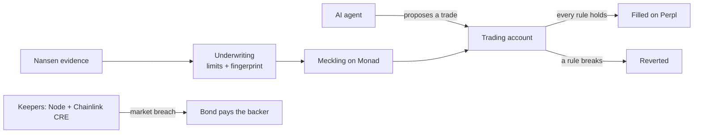

# Meckling

**AI traders that can't break your rules.**

*Formerly Mandate. Named for Jensen & Meckling (1976): when you hand an agent your money, you pay to watch it, or it posts a bond. Meckling does both, enforced on Monad.*

[](https://github.com/Demiladepy/mandate/actions/workflows/ci.yml) [](LICENSE)  

> Risk control should be a property of the infrastructure. It is unreasonable to expect everyone who funds an agent to become an expert in monitoring it.

Meckling is a risk-enforcement layer for AI trading agents on Monad. The agent trades through an account that checks its limits inside every transaction, so a trade that breaks a rule never happens. The agent's key can trade but can never move money out. And when the market alone breaks a limit, the operator's bond pays the backer back.

[**Live app**](https://meckling.vercel.app) &nbsp;·&nbsp; [Earlier demo (Sep 27)](https://youtu.be/cfVk2hWKUEA) &nbsp;·&nbsp; [**Read the manifesto**](https://meckling.vercel.app/manifesto) &nbsp;·&nbsp; [What each rule guarantees, and what it can't](docs/rules-spec.md) &nbsp;·&nbsp; [Postmortem](docs/postmortem.md)

[](https://youtu.be/cfVk2hWKUEA)

---

## Why this needs to exist

Agents with money keep failing the same way: nothing outside the model stops them.

- **aixbt** (Mar 18, 2025): two malicious replies queued through a compromised dashboard made the agent send **55.5 ETH (~$106k)** out of its wallet. ([Cointelegraph](https://www.tradingview.com/news/cointelegraph:61f9396f2094b:0-hacker-breaks-into-ai-crypto-bot-aixbt-s-dashboard-to-snatch-55-eth/), [AI Incident Database #1003](https://incidentdatabase.ai/cite/1003/))
- **Lobstar Wilde** (Feb 22, 2026): an agent sent **52.4M of its tokens** to a stranger, $250k–$441k by different reports. ([Cointelegraph](https://www.tradingview.com/news/cointelegraph:e25e7c3ff094b:0-ai-agent-sends-441k-in-tokens-after-decimal-error/))
- **Alpha Arena, Season 1** (Oct 18 – Nov 3, 2025): six frontier models got $10k each to trade crypto perpetuals on Hyperliquid. Four lost money, the worst **−62.66%**, and nothing enforced a drawdown floor. (Reported results from [nof1.ai](https://nof1.ai))

The first two are agents whose keys could send funds anywhere. A Meckling agent's key can't. The third is agents trading badly with nothing to stop the slide. Meckling stops new exposure at the limit and insures the drawdown.

Sources and the claims we checked and rejected: [`docs/research.md`](docs/research.md).

## How it works

**1. Limits from evidence.** Choose the markets an agent may trade. Meckling reads Nansen smart-money flows and perp positioning, settles a regime per market, and turns it into hard numbers: leverage, position size, allowed markets, order rate, a cooldown after losses, a drawdown floor, and optional price protection. The report is fingerprinted and stored on-chain with the mandate, so anyone can check where every number came from.

**2. The backer signs once, with a passkey.** No seed phrase, no extension (Mera). A trading account is created and the rules are written to Monad. From then on, rules can only be tightened, never loosened.

**3. Every trade is checked before it lands.** The agent holds a session key that can only place, close and cancel orders on Perpl. Each transaction measures the account before and after, and checks every rule against the result. A violation reverts the whole transaction.

**4. When the market breaks a rule, the bond pays.** A drawdown can happen with no trade at all. Anyone can flag it. The contract re-checks the breach from live state, confirms Perpl's marks against Chainlink feeds, closes the positions and locks the account to close-only. After a dispute window, the bond pays the backer the loss from peak, capped at the bond. Two keepers watch: a Node process and a Chainlink CRE workflow.



## What is guaranteed, and what isn't

The full argument, rule by rule, is in [`docs/rules-spec.md`](docs/rules-spec.md). In short:

| Guaranteed by the contracts | Not guaranteed |
|---|---|
| The agent's key can't transfer, withdraw, approve anyone but Perpl, or call any other contract | Good trading. A bad trade inside the limits is allowed |
| No agent trade ends over the leverage, position-size, market, order-rate or cooldown limits | Limits crossed by price moves alone (that's what the drawdown rule and bond are for) |
| A trade that reduces risk is never blocked, so no position can be trapped | Losses beyond the bond, or slippage while unwinding after a flag |
| Rules can only be tightened | Liveness: a breach is paid only once someone flags it (anyone can) |
| A flag succeeds only if the chain recomputes the breach and the prices check out | The dispute arbiter is a trusted role today |

## Proven, measured, tested

**On Monad testnet**, checkable on-chain. The current contracts (deployed Oct 7, with price protection and the MIP-8 storage layout):

| | |
|---|---|
| **A live Claude agent** | Account [`0xB70a…64C3`](https://meckling.vercel.app/agents/0xB70a5C4A6af38Acc1a69bAf34224ED22e8B964C3): 8 rules from a fresh Nansen report (smart money ~77% net short BTC and ETH, so risk-off and 1.5× max) plus 1% price protection, a $50 operator bond. Claude (`claude-sonnet-5-5`) opened a $100 BTC short and an $80 ETH short through every rule, then held at 0.89× because there was no new signal. |
| **A breach paid** | On account [`0xc7Eb…a30B`](https://meckling.vercel.app/agents/0xc7Eb03EDfafF6062fE756f53e7B021B495fCa30B), a BTC long fell 0.98% from its peak, past a drawdown floor its backer had tightened to 0.01%. The keeper flagged it 17 blocks after it first saw the breach (its polling had paused for hours, so the loss grew while nobody watched; see the postmortem), the account closed out, and the bond paid the backer **0.989276 AUSD**, the exact loss from peak (slash tx `0xd6f8bd6d…81dc`). |
| **No false flag** | A staged breach recovered before the CRE workflow ran; the workflow checked the account and correctly took no action. |

The first deployment (Sep 23–29, addresses below), checkable on-chain:

| | |
|---|---|
| **A trade blocked** | The agent tried 12.0× leverage against a 1.5× limit. The transaction reverted; nothing reached the exchange. |
| **A trade allowed** | It scaled to 0.7× and filled on Perpl for $143.47 notional, inside every rule. |
| **A breach paid** | The account slipped past its drawdown floor. The keeper flagged it within **6 blocks** (~2 s), closed the position in the same transaction, and after the dispute window the bond paid the backer **$0.109218**, the exact loss from peak. |
| **Flagged through Chainlink CRE** | A second breach was confirmed against Perpl's public API by the CRE workflow's nodes (median consensus) and flagged on-chain through the CRE forwarder. ([evidence](docs/cre-simulation.md)) |
| **A trader's own rules** | A self-mandate account filled a $50 long and blocked a $220 long against its owner's $250 limit. |

**Measured** (method for each in [`docs/benchmarks.md`](docs/benchmarks.md)):

| | |
|---|---|
| Gas per enforced trade, 4 rules | **499,277** vs **306,653** for the same raw Perpl order (`eth_estimateGas` on testnet, Oct 7). Enforcement costs ~193k gas. With 8 rules, 530,674. |
| MIP-8 storage layout | An enforced trade touches **3** storage pages instead of **9**. Measured on the same 4-rule account, old contracts vs new: **21,342 gas saved per trade**. |
| Monad block time | ~0.30 s, measured over 2,000 blocks (Monad states 300 ms blocks and 600 ms finality). |

**Tested and proven:**

- **Formal proofs.** 8 Halmos proofs that hold for every input within bounds: rules can only tighten, a risk-reducing trade is never blocked, each limit blocks exactly what it should, price protection can't be made to revert, and the on-chain drawdown check matches the keepers' formula exactly. 4 harder properties are fuzzed instead, and labelled as such. ([`docs/formal.md`](docs/formal.md))
- **Eight invariants** (PRD 7.8) hold over 16,384 random calls each, on every CI run.
- **Fork tests against the real Perpl exchange** at Monad mainnet state, including price protection against Perpl's live mark.

## Why Monad

- **Enforcement has to fit inside the trade.** Every rule runs inside the agent's own transaction, before Perpl sees the order. At 300 ms blocks that costs about 193k gas on a trade, measured, with no extra round trip.
- **Its storage is priced by page (MIP-8), and we built for that.** Laying each account's rules and monitors out to share pages cut 21,342 gas per enforced trade.
- **A clean record so far, stated honestly.** A three-year study of sandwich attacks on protected order flow across six chains ("No Place to Hide", [arXiv 2609.28115](https://arxiv.org/abs/2609.28115), Category Labs, ETH Zurich, Flashbots and the University of Lisbon, Sep 2026) found 28.0M on Solana and attacks on Ethereum, Tron and Base, over $346M to attackers, and none on Arbitrum or Monad. The authors note Monad has been live for less than a year, so this is partly youth, not proof. What makes it more than luck is Monad's stated direction: encrypted transactions until the order is final.
- **Where Meckling stops.** Meckling isn't MEV protection. Monad's encrypted mempool is meant to protect an order before it's included; Meckling constrains what an agent's included orders can do.

## Where this goes

Monad co-founder Keone Hon describes the next phase with "fair execution should be a property of the infrastructure" (["A world computer worthy of the world's money"](https://x.com/keoneHD/status/2106670836761633202), Oct 4, 2026). Three items on that roadmap extend Meckling directly, and the third shipped as an announcement two days later:

- **Encrypted transactions until the order is final.** An agent's intent with its limits ("at most X, no further than Y from the mark") is what a mandate with price protection already expresses. With encrypted submission, it also couldn't be traded ahead of.
- **Application-specific sequencing**, such as "an exchange may need to process cancellations before new orders." Meckling's breach handling already applies one such rule inside a transaction: unwind first, then close-only. Sequencing would let it apply across transactions.
- **Private settlement.** Category Labs announced [Monad Private Settlement](https://www.category.xyz/monad-private-settlement) at Monad Open (Oct 6, 2026): institutions keep trading positions and orders encrypted in their own domain, settle against public Monad liquidity, and open specific information to regulators and auditors. A fund there can't publish its positions, but it can publish its mandate. Its limits and breach record stay public and enforced on-chain, so "this fund never exceeds 2× leverage" becomes checkable without revealing a single position.

**Agent keys.** The author's Ledger N3xt paper, ["The Agent Key Lifecycle: Rotation and Revocation"](https://www.ledger.com/academy/series/n3xt/research-agent-key-lifecycle-rotation-revocation), found that rotation, delegation withdrawal and retirement of agent keys have no published mechanism. Meckling gives each one an on-chain answer: a scoped session key with an expiry block, replaced in one transaction, revocable by the owner or operator, with a blast radius bounded by the rules. An agent's authority lives in its account, not its key, so the key can move to a post-quantum scheme without touching the rules.

**Quantum readiness.** Monad's [post-quantum roadmap](https://monad.xyz/blog/post-quantum-roadmap) (Sep 28, 2026) puts protecting user funds first, through a draft where "an account stores its authentication configuration in state; its address stays fixed while the credentials that control it can change." Meckling refers to the owner, the agent's key and the backer only by address. So when those accounts add post-quantum credentials under that design, every Meckling account, its rules and its bond carry over unchanged: no migration, no new contracts. Until then, a stolen agent key is already bounded: it can't withdraw, and every trade still passes the rules. Today's keys are ordinary secp256k1 keys, like every other account on Monad.

## Built with

| | Role in Meckling | Status |
|---|---|---|
| [**Monad**](https://www.monad.xyz) | Where every rule is enforced. Storage laid out for MIP-8 pages | Live on testnet |
| [**Perpl**](https://perpl.xyz) | The on-chain order book every trade goes to; the account trades in its own name | Live |
| **Mera** | Passkey accounts; the agent's private reasoning is encrypted to the backer's passkey | Sign-in live · private reasoning built, phone test pending |
| **Agora AUSD** | The collateral every account holds and every bond pays out in | Live |
| [**Chainlink**](https://chain.link) | Price feeds guard every breach; a CRE workflow confirms and flags breaches | Live (a real breach flagged through CRE) |
| [**Envio**](https://envio.dev) | Indexes track records and breach history, which Monad nodes don't serve | Live |
| [**Nansen**](https://www.nansen.ai) | Smart-money evidence becomes the agent's limits; the report is fingerprinted on-chain | Live |
| **Upstash** | Agent logs and the judge faucet's rate limits | Built · live with the next deploy |
| [**QuickNode**](https://www.quicknode.com) | Private RPC, kept server-side | Live |
| **Claude** | The agent's reasoning model | Integrated |

## Try it (judges)

1. Open the [live app](https://meckling.vercel.app) and sign in with a passkey. Nothing to install.
2. Tap **Get test funds**: the faucet sends test MON and AUSD to your new account (rate-limited). *The faucet switches on with the next deploy, planned for Oct 5.*
3. Go to **Trade**, set your own limits, and try a trade over them. It reverts on-chain.

Everything runs on Monad testnet with test AUSD.

## Honest notes

- **The demo agent in the video is scripted.** Its reasoning comes from a scripted provider that quotes the real Nansen report and deliberately tries 12× leverage to test the limits. The blocked transaction, the fill and the breaches are real on-chain events. The runtime also runs Claude.
- **The first breach was flagged by the fallback keeper**, which runs the same checks as the CRE workflow. CRE flagged its own breach later.
- **Local-fork tools refuse to run on real networks.** The price-sync script for anvil forks only runs against localhost.
- **Testnet only, unaudited.** Proofs, invariants and fork tests are not an audit.
- **The live agent's earlier history is on the first deployment.** The Oct 7 redeploy brought new addresses; the blocked 12× trade, the paid breach and the CRE flag happened on the first deployment and stay checkable there.
- Every failure we hit, and what we changed: [`docs/postmortem.md`](docs/postmortem.md).

## Contracts on Monad testnet

Current (deployed Oct 7, 2026, from block 68,815,384):

| Contract | Address |
|---|---|
| MandateRegistry | `0x9E1C7e886Da953B96D091D1b8324c69F0260bc68` |
| MandateAccountFactory | `0xA8A3dB9d38187dA5Df7d79E45234d3322D9F4581` |
| PerplAdapter | `0x47c0ac6203E321d2Bc797fB97298900f584D3716` |
| OracleGuard | `0x7642e42A07074f70cB45aBC713D26D9c96C608d9` |
| BondVault | `0x8CA4854e7fB030ec9168f197450E16A305c2600B` |
| CRE receiver | `0x129712c1b853067e0f5c1b9f214397c719a6242B` |
| Live agent account | `0xB70a5C4A6af38Acc1a69bAf34224ED22e8B964C3` |
| Its report fingerprint | `0x977e286d510488cef67012b6f9c9a1c25ceaab30be6f3556ca0be487aecbe171` |

First deployment (Sep 23), where the blocked trade, the paid breach and the first CRE flag happened:

| Contract | Address |
|---|---|
| MandateRegistry | `0x9e6F25f2291AFD83d56fFf502670Dcc781E2A133` |
| BondVault | `0xe6FB91056f899656d3700DbDb7BcE5680984686f` |
| CRE receiver | `0x0ebECec6eA87650D9bBcc4F553d0f4713b09beAc` |
| Agent account | `0xAdb15A72D8e01FC641ad2E218E060e434f2610e0` (report `0x0882f77c…c9a66`) |

## Repository

```
contracts/          Solidity (Foundry): registry, trading account and factory, one library per rule,
                    Perpl adapter, oracle guard, bond vault, CRE receiver, Curvance collateral adapter
  test/formal/      Halmos proofs of the rule libraries
services/
  common/           Shared ABIs, network config, Perpl encoding, rule logic and copy, sealed agent memory
  underwriter/      Nansen evidence → regime → limits → report fingerprint
  agent/            The agent runtime (Claude or the scripted demo)
  keeper-cre/       The keeper as a Chainlink CRE workflow
  keeper-relayer/   The same keeper as a plain process
indexer/            Envio HyperIndex: track records, breaches, equity curves
app/                Next.js PWA: landing, agents, underwriting, agent screen, risk, trade, faucet
docs/               Spec, rule guarantees, proofs, benchmarks, research, postmortem, decisions, spikes
```

## Quickstart

Requirements: Node 22+, pnpm 10, Foundry, and a Nansen API key.

```bash
git clone --recurse-submodules https://github.com/Demiladepy/mandate.git
cd mandate
cp .env.example .env        # add NANSEN_API_KEY, and a Monad testnet RPC if you have one
pnpm install
NETWORK=testnet pnpm --filter app dev
```

Then open <http://localhost:3000>.

### Tests

```bash
pnpm verify                                              # everything CI runs, locally
cd contracts && forge test                               # unit, property and invariant tests
cd contracts && FOUNDRY_PROFILE=fork forge test -vv      # real Perpl on a mainnet fork (needs MONAD_RPC_URL)
cd contracts && halmos --contract RuleProofs --solver-command "python test/formal/yices_all_logic.py"
```

## How this was built

**AI coding tools.** Meckling was built with heavy use of AI coding assistants, as the Metropolis rules permit and require us to disclose: **Claude Code** (Anthropic) and **Cursor** wrote much of the code, tests and documentation under the author's direction. Every contract change is covered by Foundry tests, every address and interface was checked on-chain before use (`docs/spikes.md`), and the product decisions are recorded in `docs/decisions.md`. Separately, the agent inside the product uses Claude as its reasoning model.

**Build window.** All of Meckling's code was written during the hackathon. The first commit is dated September 21, 2026, and the full history is public. No pre-existing project code was reused.

**Third-party code.** Meckling builds on, and does not copy, the following:

| Component | Used for | License |
|---|---|---|
| [forge-std](https://github.com/foundry-rs/forge-std) | Contract tests | MIT / Apache-2.0 |
| [OpenZeppelin Contracts](https://github.com/OpenZeppelin/openzeppelin-contracts) | `SafeERC20`, `ReentrancyGuard`, `Ownable2Step`, ERC-20 interfaces | MIT |
| [Halmos](https://github.com/a16z/halmos) | Symbolic proofs | AGPL-3.0 (a dev tool, not shipped) |
| [viem](https://viem.sh) | Chain reads and writes in every service and the app | MIT |
| [Next.js](https://nextjs.org), React | The web app | MIT |
| [@category-labs/mera](https://mera.category.xyz) | Passkey accounts | per package |
| [@noble/curves, @noble/hashes, @noble/ciphers](https://github.com/paulmillr) | Encrypting the agent's memory to the backer | MIT |
| [@scure/bip32, @scure/bip39](https://github.com/paulmillr) | Deriving the account key from the passkey | MIT |
| [@chainlink/cre-sdk](https://docs.chain.link/cre) | The keeper workflow | per package |
| [Envio HyperIndex](https://envio.dev) | The indexer | per package |
| [@upstash/redis, @upstash/ratelimit](https://upstash.com) | Agent logs, faucet limits | MIT |
| [@anthropic-ai/sdk](https://github.com/anthropics/anthropic-sdk-typescript) | The agent's reasoning model | MIT |
| [zod](https://zod.dev) | Validating model output and API input | MIT |
| Perpl exchange ABI from [PerplFoundation/dex-sdk](https://github.com/PerplFoundation/dex-sdk) | The Perpl adapter's interface | per repo |
| Curvance interfaces from [curvance-web/sdk](https://github.com/curvance-web/sdk) | The collateral adapter's interface | per repo |

## License

[MIT](LICENSE).

## Documentation

| | |
|---|---|
| [Rule guarantees](docs/rules-spec.md) | What each rule guarantees, where it's enforced, the evidence, and what it can't prevent |
| [Formal checks](docs/formal.md) | Which properties are proven, which are fuzzed, and how to run them |
| [Benchmarks](docs/benchmarks.md) | Measured numbers and how each was measured |
| [Research](docs/research.md) | The argument, the incidents and comparables, and the claims we rejected |
| [Postmortem](docs/postmortem.md) | What broke while building, and what changed |
| [Specification](docs/PRD.md) | What Meckling is, the rules it enforces, and the invariants |
| [Decisions](docs/decisions.md) | Rulings that refine the specification |
| [Spikes](docs/spikes.md) | Measured facts about Monad, Perpl, Nansen and the rest |
| [Plan](docs/plan.md) | Milestones, what is done and what is next |

---

Built for Monad Metropolis 2026 (Track 01, Onchain Finance & Trading). An earlier version was submitted to the Nansen Meridian Buildathon in September 2026, under the name Mandate.
