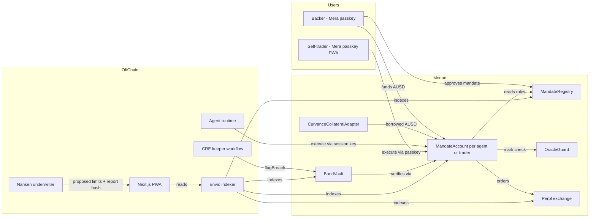

# Mandate — Product Requirements Document

Version 1.0 · Owner: Demilade (0xharp) · Written Sep 21, 2026
Build target: Monad Metropolis (submissions close Oct 13, 2026) and Nansen Meridian Buildathon (closes Sep 27, 2026)

---

## 0. Instructions for the coding agent (read first, every session)

You are building Mandate, a risk-enforcement and capital layer for AI trading agents on Monad. This document is the single source of truth. Follow these rules:

1. **Work milestone by milestone** (section 4). Do not start a milestone's work until the previous milestone's exit criteria pass, except where a task is marked "parallel".
2. **Spikes decide architecture.** Section 5 lists Day-0 spikes. Run them before writing product code. Record each result in `docs/spikes.md`. If a spike fails, follow its fallback. Do not guess an ABI or endpoint; read the docs or the deployed contract.
3. **Contracts are test-first.** Every contract function ships with Foundry unit tests. Every invariant in section 7.6 ships as a Foundry invariant test. No contract is "done" without them.
4. **No scope that is not in this document.** If something seems useful but is not listed, write it in `docs/ideas.md` and move on. Scope changes are made by the owner, not the agent.
5. **Every bounty integration must be load-bearing.** If removing an integration would not break a user-visible feature, it does not count. Section 3 defines what "load-bearing" means per bounty.
6. **Monad rules** (from Monad docs; verify against `docs.monad.xyz/developer-essentials/differences`):
   - Several consecutive blocks can share one `block.timestamp`. All time windows use `block.number`, never timestamps.
   - Gas is charged on the gas limit, not gas used. Set tight gas limits on every transaction the agent or keeper sends.
   - A 7702-delegated EOA cannot drop below 10 MON. Do not use 7702 for agent accounts.
   - Full nodes do not serve arbitrary historical state. Anything historical comes from the Envio indexer.
   - Block time is a config value measured at startup, not a hardcoded constant.
7. **Commit discipline.** Small commits with clear messages. The judges must be able to verify everything was built after Sep 1, 2026.
8. **Never commit secrets.** Keys, API keys and RPC URLs with credentials live in `.env`, which is gitignored. Provide `.env.example`.

---

## 1. Product

### 1.1 One sentence

Mandate lets anyone fund an AI trading agent on Monad and makes it impossible for the agent to break the risk rules they set: rules the agent could break are reverted inside its own trade, and rules the market breaks are caught on-chain and paid out from the operator's bond.

### 1.2 The problem

AI agents are starting to manage real capital. Nansen is shipping agentic trading, MetaMask shipped an Agent Wallet on Monad, and Monad joined the agentic payment alliances. But nobody can safely hand capital to an agent they don't fully trust. Today's controls are either off-chain policy engines (you trust whoever runs the server) or simple per-transaction spend caps (they can't express rules over time, like "max 5% drawdown from the equity peak" or "no new position for 150 blocks after a loss").

### 1.3 The primitive

A **mandate** is a set of risk rules attached to an agent's on-chain trading account. Rules come in two classes:

- **Action rules** — rules the agent's own trade could break (leverage, position size, allowed markets, order rate, cooldown after a loss). The trading account checks them after every trade inside the same transaction and reverts on violation. A violation never lands on-chain.
- **Market rules** — rules the market can break without the agent acting (drawdown from equity peak). Anyone can report a violation, but the report only succeeds if the contract itself recomputes the violation from on-chain state. Then the position unwinds and, after a dispute window, the operator's bond pays the backer.

Several rules are **temporal**: they depend on history, not just the current state (rolling windows, cooldowns, equity peaks). Each temporal rule compiles to a small on-chain state machine with constant-size state, updated on every trade and every keeper check. This is past-time temporal logic enforced by the EVM.

### 1.4 Why only Monad

- Checking every rule after every trade costs gas on every trade. At Monad's gas prices it costs fractions of a cent.
- Market rules need per-block monitoring. Monad's short blocks make "caught within a few blocks" mean well under a few seconds.
- Perpl runs a fully on-chain central limit order book, so positions and marks are on-chain state the contracts can read. Nowhere else in the EVM world has both.

### 1.5 Users

| User | What they do | Why they care |
|---|---|---|
| **Backer** | Funds an agent with AUSD (or with yield-bearing collateral via Curvance) and sets or approves its mandate | Gets agent returns with downside capped by code, plus the bond as insurance |
| **Operator** | Runs an agent, posts a bond, earns a performance fee | Can raise capital without being trusted personally |
| **Self-mandated trader** | Trades on Perpl from a phone, under rules they set for themselves (for example, a cooldown after a loss) | Can't blow up their own account on a bad night. This is the consumer surface and the Agora bounty surface |

### 1.6 Non-goals

Mobile-native app (a PWA is the mobile surface), social or copy-trading layer, leaderboard as the centerpiece, token, governance, multi-venue routing, Kuru integration, MetaMask Agent Wallet plugin, ZK proofs. These go on the "where this goes" slide only.

---

## 2. Win conditions

1. **Grand Champion and Onchain Finance & Trading track.** Judged by the main panel (investors plus Monad Foundation). They reward a new primitive, a real reason it needs Monad, a clear business, and a demo that makes them lean forward.
2. **At least two sponsor bounties** (section 3).
3. **Nansen Meridian Buildathon** (Sep 14–27), with the Nansen underwriting slice shipped by Sep 27.

Three measured numbers are published in the README and the demo (section 13): gas per enforced trade, blocks from market breach to on-chain flag, and fixed Ultrafuzz findings.

---

## 3. Bounty eligibility map

Every row says what the sponsor asked for, how Mandate satisfies it, and the evidence that must exist at submission. If the evidence column can't be produced, the bounty is dropped, not faked.

| Bounty | Prize | Sponsor's requirement | How Mandate satisfies it (load-bearing) | Evidence at submission |
|---|---|---|---|---|
| **Perpl: Best use of Perpl's API** | $5,000 | Production-ready trading bot or automation system on Perpl | The agent runtime is a trading bot whose every order goes to Perpl through the mandate account; the keeper automates risk monitoring on Perpl positions | Mainnet or testnet Perpl fills from mandate accounts; agent runtime code; video of live trading |
| **Perpl: Best Analytics / Risk Tool** | $3,000 | Real-time analytics, risk-monitoring or portfolio intelligence dashboard focused on Perpl | The Risk screen: live leverage, equity vs peak, rule headroom and breach history per Perpl account, fed by Envio and Perpl WebSocket | Live dashboard URL; screen recording |
| **Agora: Best Mobile Trading App** | $10,000 | Mobile app authenticating via Mera, holding an AUSD balance, executing trades through Perpl. **A PWA is accepted (confirmed by Agora).** | Self-mandate mode: a PWA where the user signs in with a Mera passkey, holds AUSD, and trades on Perpl through their own mandate account | Installable PWA URL; phone screen recording of sign-in, AUSD balance, trade, and a blocked trade |
| **Mera: Best Mera-Powered UX** | $2,500 | Mera is the entire account layer: no seed phrase, no extension, no custody backend | All human accounts (backer, operator, self-trader) are Mera passkey accounts. Agent session keys are separate and scoped by the mandate, not custody of user funds | Sign-up to first trade with no seed phrase or extension, on video |
| **Chainlink: Best workflow with CRE** | $3,000 | Build, simulate or deploy a CRE workflow used as an orchestration layer | The keeper is a CRE workflow: it watches mandate accounts each interval, checks market rules and calls `flagBreach`. If CRE can't write to Monad (spike S4), the workflow is simulated and a fallback relayer runs the same logic, as the bounty allows simulation | Workflow source; CRE simulation logs; on-chain `BreachFlagged` events |
| **Nansen: Best use of Nansen** (+ Meridian Buildathon) | $5,000 pool | Product experience powered by Nansen data, API, MCP or CLI that goes beyond exposing raw data | Nansen underwriting: smart-money flows and related signals are turned into proposed mandate limits. The backer approves them, and the report hash is stored on-chain with the mandate. The agent's strategy also consumes Nansen signals | Underwriting report UI; on-chain `reportHash`; code calling the Nansen API |
| **Envio: Best Use of Envio** | $1,000 | HyperIndex, HyperSync or HyperRPC powering real on-chain data behind a core feature | The indexer is the only source for track records, breach history and the Risk screen (Monad full nodes don't serve history) | Indexer repo folder; hosted GraphQL endpoint; dashboard reading it |
| **Kimi: Best builds powered by KIMI** (optional) | $3,000 credits | Project genuinely powered by Kimi | Only if the agent's reasoning model is Kimi. Decide in M1 based on quality; if another model is used, drop this bounty | Agent config and logs showing Kimi calls |

Explicitly **not** targeted: Kuru, Dynamic, Privy (conflicts with Mera as the whole account layer), Aurora Intents, Cleanverse, Qwen and Hunyuan (other tracks), MetaMask plugin, Alchemy (optional $1K in credits only if Alchemy RPC or webhooks end up used anyway).

**Main track selection:** Onchain Finance & Trading.

---

## 4. Milestones

Deadlines are hard. Each milestone has exit criteria that must pass before it's called done.

### M0 — Spikes and scaffold (Sep 22)
- Run all spikes in section 5. Record results in `docs/spikes.md`.
- Monorepo scaffold (section 6.2), Foundry project, Next.js PWA shell, `.env.example`, CI running `forge test`.
- **Exit:** spikes S1 and S2 have a recorded answer; `forge test` runs in CI.

### M1 — Nansen slice and enforcement core (Sep 23–27) → Nansen Meridian submission Sep 27
- `MandateRegistry`, `MandateAccount` with action rules: `MaxLeverage`, `MaxNotionalPerMarket`, `AllowedMarkets`, `OrderRateLimit`, `LossCooldown`.
- `PerplAdapter` (per spike S1).
- Nansen underwriting service and "Create mandate" screen (section 9).
- Agent runtime placing real Perpl orders through `MandateAccount.execute`.
- Minimal split-screen agent view (section 11.4) showing a blocked trade.
- **Exit:** a recorded run where the agent trades on Perpl, then attempts a trade that breaks a Nansen-proposed limit, and the transaction reverts with `MandateViolation`. Submit to Nansen Meridian with that recording.

### M2 — Market rules, bond and keeper (Sep 28–Oct 3)
- `MaxDrawdown` market rule with equity peak tracking.
- `BondVault`: post, flag, dispute window, slash, resolve.
- Oracle guard (section 7.5).
- CRE keeper workflow (section 10), plus a fallback relayer running the same logic.
- Envio indexer (section 10.3).
- **Exit:** full demo loop on testnet or mainnet: action breach reverts; market move triggers a breach; keeper flags it; position unwinds; bond is slashed to the backer after the dispute window.

### M3 — Capital, mobile and risk surfaces (Oct 4–8)
- Mera passkey accounts across the app.
- Self-mandate mode PWA (Agora surface).
- Risk screen (Perpl risk bounty surface).
- `CurvanceCollateralAdapter` (per spike S2), built last within M3.
- **Exit:** from a phone, sign in with Mera, see an AUSD balance, place a Perpl trade under a self-mandate, and have a rule-breaking trade blocked, all on video.

### M4 — Hardening and story (Oct 9–11)
- Run Ultrafuzz on `contracts/`. Fix findings. Commit the report to `docs/security/ultrafuzz-report.md`.
- Publish benchmark numbers (section 13).
- Landing page, README, demo video (section 14).
- **Exit:** submission checklist (section 15) fully checked.

### Buffer (Oct 12–13)
Submission on Oct 12. Oct 13 is buffer only. Note that the Crypto World's Fair also ends Oct 12; Mandate must be submission-ready by the end of Oct 11.

---

## 5. Day-0 spikes

Each spike has a question, a method and a fallback. Do not skip these.

### S1 — Can a smart contract trade on Perpl? (blocking)
- **Question:** Can a contract account (not an EOA) deposit AUSD, place and cancel orders, and hold a position on Perpl's exchange contract?
- **Method:** Read Perpl's docs (`docs.perpl.xyz/resources/for-developers`), SDK and API docs (`github.com/PerplFoundation/api-docs`). Find how the exchange identifies an account: `msg.sender`, an EIP-712 signature, or an API session. Read the verified exchange contract on the explorer (mainnet exchange `0x34B6552d57a35a1D042CcAe1951BD1C370112a6F`, testnet `0x1964c32f0be608e7d29302aff5e61268e72080cc`; mainnet collateral token is AUSD `0x00000000eFE302BEAA2b3e6e1b18d08D69a9012a`). Then write a Foundry fork test where a test contract deposits and places a small order.
- **Pass:** `MandateAccount` calls the exchange directly. Proceed as specified.
- **Fallback A:** If orders require EIP-712 signatures, check whether the exchange accepts ERC-1271 contract signatures. If yes, `MandateAccount` implements `isValidSignature`, and signs only when the mandate check on the simulated post-trade state passes.
- **Fallback B:** If neither works, enforcement moves to a pre-trade guard: the agent submits intended orders to `MandateAccount.authorize(order)`, which checks rules and emits a one-time authorization the off-chain relayer must present. Document this weakening honestly in the README. Tell the owner the same day.
- Also record: Perpl builder or referral ID requirements, rate limits, and whether testnet and mainnet market IDs differ (they do: store per-network market maps).

### S2 — Curvance: borrow AUSD against yield-bearing collateral
- **Question:** Which collateral assets let you borrow AUSD on Curvance today (hyAUSD, PT-AUSD or others)? What are the LTV and liquidation thresholds? Is there an SDK path (`docs.curvance.com/app/developer-docs/sdk`)?
- **Fallback:** If no suitable market exists, the collateral adapter is cut from the demo and described as roadmap. Backers fund with AUSD directly.

### S3 — Mera passkey accounts
- **Question:** How does Mera create an account, sign transactions and expose PRF-derived keys from a web app? Read `docs.monad.xyz/guides/mera`. Does it work in mobile Safari and Chrome as a PWA?
- **Fallback:** None. Mera is required for Agora and Mera bounties. If blocked, escalate to the owner immediately.

### S4 — Chainlink CRE on Monad
- **Question:** Can a CRE workflow read Monad state and write a transaction to a Monad contract? Which SDK (TypeScript or Go)?
- **Fallback:** The workflow runs in CRE simulation and a fallback relayer (same code path, same checks) submits the transaction. The bounty explicitly accepts "build, simulate, or deploy".

### S5 — Price sources
- **Question:** Where does Perpl publish its mark price (contract read or API)? Which Chainlink feeds or Data Streams exist on Monad for the markets we trade (BTC, ETH, MON)?
- **Output:** The oracle guard design in section 7.5 uses both.

### S6 — Nansen API
- **Question:** Which endpoints are available on the owner's plan (base `https://api.nansen.ai/api/v1`)? Confirm smart-money netflow, holders, and smart-money PnL leaderboard endpoints, and which chains they cover. Does Nansen cover Monad directly? If not, underwrite on the underlying assets' flows on other chains.
- **Output:** `services/underwriter/nansen.ts` with typed clients for the confirmed endpoints only.

### S7 — Envio on Monad
- **Question:** Confirm HyperIndex supports Monad mainnet (chain ID 143) and testnet (10143), and whether Perpl events can be indexed alongside our contracts.

---

## 6. System architecture

### 6.1 Components



### 6.2 Repository layout

```
mandate/
  contracts/            Foundry project
    src/
      MandateRegistry.sol
      MandateAccount.sol
      MandateAccountFactory.sol
      BondVault.sol
      OracleGuard.sol
      rules/            one library per rule
      venues/IVenue.sol
      venues/PerplAdapter.sol
      collateral/CurvanceCollateralAdapter.sol
    test/               unit + invariant + fork tests
  services/
    agent/              agent runtime (TypeScript)
    underwriter/        Nansen underwriting (TypeScript)
    keeper-cre/         Chainlink CRE workflow
    keeper-relayer/     fallback relayer (same logic)
  indexer/              Envio HyperIndex project
  app/                  Next.js PWA
  docs/
    spikes.md
    ideas.md
    security/
    benchmarks.md
```

### 6.3 Stack
- Contracts: Solidity, Foundry, Tenderly for debugging (claim the Tenderly perk).
- Services: TypeScript, viem.
- Frontend: Next.js (App Router), TypeScript, installable PWA manifest and service worker.
- Indexer: Envio HyperIndex, GraphQL.
- RPC: QuickNode (claim the perk) with the public RPC as fallback.

---

## 7. Smart contracts

All contracts are non-upgradeable. Each has a named owner role limited to documented admin functions (setting the oracle guard, pausing new mandates). No admin can move user funds.

### 7.1 IVenue (venue abstraction)

The core never calls Perpl directly; it calls a venue adapter. This isolates the unknowns from spike S1.

```solidity
interface IVenue {
    struct AccountState {
        int256 equity;            // collateral + unrealized PnL, in collateral units (AUSD, 6 decimals — verify)
        uint256 totalNotional;    // sum of |position size * mark| across markets
        uint256 marginUsed;
    }
    struct MarketState {
        int256 size;              // signed position size
        uint256 mark;             // venue mark price
        uint256 notional;
    }
    function accountState(address account) external view returns (AccountState memory);
    function marketState(address account, uint256 marketId) external view returns (MarketState memory);
    function collateralToken() external view returns (address);
    // Encodes calls the MandateAccount will make; the adapter never holds funds.
    function encodeDeposit(uint256 amount) external view returns (address target, bytes memory data);
    function encodePlaceOrder(uint256 marketId, bool isBuy, uint256 size, uint256 limitPrice, bool reduceOnly)
        external view returns (address target, bytes memory data);
    function encodeCancel(uint256 marketId, uint256 orderId) external view returns (address target, bytes memory data);
    function encodeCloseAll(address account) external view returns (address[] memory targets, bytes[] memory datas);
}
```

`PerplAdapter` implements this after spike S1. If a function above is impossible on Perpl, change the interface and record why in `docs/spikes.md`.

### 7.2 MandateRegistry

Stores each account's mandate and the rules' parameters.

```solidity
enum RuleKind { MaxLeverage, MaxNotionalPerMarket, AllowedMarkets, OrderRateLimit, LossCooldown, MaxDrawdown }

struct Rule {
    RuleKind kind;
    uint256 p1;     // meaning depends on kind (see 7.4)
    uint256 p2;
    uint256 p3;
}

struct Mandate {
    address account;          // the MandateAccount
    address backer;
    address operator;         // zero for self-mandates
    Rule[] rules;
    bytes32 reportHash;       // hash of the Nansen underwriting report (zero if none)
    uint64 createdAtBlock;
    uint64 disputeWindowBlocks;
    bool active;
}

function createMandate(address account, Rule[] calldata rules, bytes32 reportHash, uint64 disputeWindowBlocks)
    external returns (uint256 mandateId);
function tightenRule(uint256 mandateId, uint256 ruleIndex, Rule calldata newRule) external; // backer only; can only make rules stricter
function deactivate(uint256 mandateId) external; // backer only; account moves to close-only mode

event MandateCreated(uint256 indexed mandateId, address indexed account, address indexed backer, bytes32 reportHash);
event RuleTightened(uint256 indexed mandateId, uint256 ruleIndex);
```

Rules can only be tightened after creation, never loosened. Loosening requires a new mandate, which requires the operator's agreement and a fresh bond check. This prevents a compromised backer key from silently raising risk.

### 7.3 MandateAccount

One per agent or self-trader, deployed by `MandateAccountFactory` (CREATE2 for deterministic addresses). Holds AUSD and the venue position.

```solidity
function execute(Call[] calldata calls) external returns (bytes[] memory results);
// Callable by: the session key (agent) or the owner (self-trader via Mera).
// 1. Snapshot pre-state from the venue.
// 2. Perform calls. Targets must be the venue or the collateral token; anything else reverts.
// 3. Snapshot post-state.
// 4. Update temporal monitor state (7.4).
// 5. Evaluate every action rule; on the first violation:
//    revert MandateViolation(ruleIndex, observed, limit)
// 6. Emit Executed(...) with post-state summary.

function setSessionKey(address key, uint64 expiresAtBlock) external;   // owner only
function revokeSessionKey() external;                                  // owner or backer
function closeOnly() external view returns (bool);                     // true after a breach flag or deactivation
function unwind() external;                                            // callable by BondVault after a valid flag; closes all positions via venue
function withdraw(uint256 amount, address to) external;                // owner/backer; blocked while positions open unless closeOnly

error MandateViolation(uint256 ruleIndex, int256 observed, int256 limit);
error TargetNotAllowed(address target);
error CloseOnlyMode();

event Executed(address indexed account, uint256 blockNumber, int256 equity, uint256 notional);
event MonitorUpdated(address indexed account, uint256 ruleIndex, bytes32 stateHash);
```

In close-only mode, `execute` accepts only reduce-only orders and cancels.

Session keys: agent keys are scoped to `execute` on this account only, with an expiry block. They can never call `withdraw`, `setSessionKey` or anything on `BondVault`.

### 7.4 Rules and their monitors

Parameters are in basis points (bps) or raw units as noted. All windows count blocks.

| Rule | Class | Parameters | Check | Monitor state |
|---|---|---|---|---|
| `MaxLeverage` | Action | p1 = max leverage in bps of equity (e.g. 30000 = 3x) | `totalNotional * 10000 <= p1 * equity` after the trade | none |
| `MaxNotionalPerMarket` | Action | p1 = marketId, p2 = max notional | `marketState(marketId).notional <= p2` | none |
| `AllowedMarkets` | Action | p1 = bitmap of allowed market IDs | every market with a nonzero position is in the bitmap | none |
| `OrderRateLimit` | Action | p1 = max orders, p2 = window in blocks | orders in the current window `<= p1` | window start block + count (fixed windows) |
| `LossCooldown` | Action, temporal | p1 = loss threshold, p2 = cooldown blocks | if a trade realizes a loss `>= p1`, then for the next `p2` blocks any trade that increases `totalNotional` reverts | last big-loss block |
| `MaxDrawdown` | Market, temporal | p1 = max drawdown in bps from equity peak | `equity >= peak * (10000 - p1) / 10000` | equity peak (updated on every execute and every keeper check) |

`LossCooldown` is the showcase temporal rule: it's the rule a human trader understands instantly ("no revenge trading"), and it can't be expressed as a per-transaction spend cap.

Implementation note: each rule is a library with `update(state, pre, post)` and `check(state, post, params)`. Adding a rule never changes `MandateAccount`'s control flow.

### 7.5 OracleGuard

Protects against false breach flags from a manipulated mark.

- Reads the venue mark (from the adapter) and a Chainlink price for the same market (spike S5).
- `markIsTrusted(marketId)` returns true only if the two are within a tolerance band (default 50 bps, configurable per market) and the Chainlink value isn't stale (max age configured in blocks and seconds).
- `flagBreach` for market rules requires `markIsTrusted` on every market with an open position. If the guard fails, the flag reverts; the keeper retries next interval.

### 7.6 BondVault

```solidity
function postBond(address account, uint256 amount) external;              // operator; AUSD
function flagBreach(address account, uint256 ruleIndex) external;         // anyone; succeeds only if the contract verifies the breach
// 1. require rule is a market rule
// 2. require OracleGuard.markIsTrusted for open markets
// 3. recompute the rule from live venue state and monitor state; require violation
// 4. record Breach{account, ruleIndex, observed, limit, block, markSnapshot}
// 5. MandateAccount.unwind(); account enters close-only
// 6. emit BreachFlagged
function dispute(uint256 breachId, bytes calldata reason) external;       // operator; within dispute window
function resolveDispute(uint256 breachId, bool upheld) external;          // arbiter (configured per mandate; for the demo, a 2-of-2 of backer and operator or a set address)
function slash(uint256 breachId) external;                                // anyone, after the window with no open dispute
// slash amount = min(bond, backer's loss from peak equity), paid to the backer
function withdrawBond(address account) external;                          // operator; only when the mandate is inactive and no breach is pending

event BondPosted(address indexed account, uint256 amount);
event BreachFlagged(uint256 indexed breachId, address indexed account, uint256 ruleIndex, int256 observed, int256 limit, uint256 blockNumber);
event Disputed(uint256 indexed breachId);
event Slashed(uint256 indexed breachId, address indexed backer, uint256 amount);
```

### 7.7 CurvanceCollateralAdapter (M3, built last)

Per spike S2. The backer deposits a yield-bearing asset (for example PT-AUSD), the adapter supplies it to Curvance, borrows AUSD at a conservative LTV (at most 50% of Curvance's maximum), and funds the `MandateAccount`. Adds a market rule `CollateralHealth` (p1 = minimum health factor in bps) checked by the keeper. If spike S2 fails, skip this section entirely.

### 7.8 Invariants (Foundry invariant tests; also the property list for Ultrafuzz)

1. After any successful `execute`, every action rule holds.
2. A `MandateAccount` never transfers tokens to any address other than the venue, the collateral token contract, the owner or backer (on withdraw), or the BondVault.
3. A session key can never cause funds to leave the account except into the venue.
4. Rules can only be tightened, never loosened, on an existing mandate.
5. `flagBreach` succeeds only if the recomputed rule is violated and the oracle guard passes.
6. Bond slashed for a breach never exceeds the posted bond, and no breach is slashed twice.
7. After a breach is flagged, the account accepts only reduce-only orders and cancels.
8. The equity peak is non-decreasing between breaches.

---

## 8. Agent runtime (`services/agent`)

- TypeScript process that holds a session key for one `MandateAccount`.
- Loop every N blocks (config): read Nansen signals (section 9) and Perpl market data, decide an action with an LLM, submit `execute` with tight gas limits.
- **Reasoning log:** every decision writes a short structured record (`{block, intent, reasoning, proposedOrder, result, txHash, revertReason}`) to the app's backend (or to IPFS plus an event, if time allows). The split screen (section 11.4) reads it.
- **Demo mode flag:** a scripted mode that deliberately proposes one rule-breaking trade (for example 12x leverage against a 3x limit) so the demo is repeatable. The flag and the fact it's scripted are disclosed in the README.
- Model: decided in M1. If Kimi quality is adequate, use Kimi (optional bounty). Otherwise use the best available model and drop the Kimi bounty.
- Never holds user funds; never has a key that can withdraw.

---

## 9. Nansen underwriting (`services/underwriter`)

This is the Nansen bounty and the Meridian Buildathon submission. It must do more than display Nansen data: it converts Nansen evidence into **enforced on-chain limits**.

**Flow**
1. Backer picks an agent and the markets it may trade.
2. Underwriter pulls Nansen data for each market's underlying asset (endpoints confirmed in spike S6): smart-money netflow, holder concentration, smart-money PnL leaders' positioning.
3. It computes a risk regime per market (for example: smart money net selling hard → "risk-off" regime).
4. It proposes rule parameters from a transparent table, for example:

   | Regime | Max leverage | Max notional per market | Loss cooldown |
   |---|---|---|---|
   | Risk-on | 5x | base | 50 blocks |
   | Neutral | 3x | 0.7 × base | 150 blocks |
   | Risk-off | 1.5x | 0.4 × base | 600 blocks |

5. The UI shows the evidence (with Nansen attribution), the regime, and the proposed limits. The backer can accept or tighten, never loosen beyond the proposal without an explicit override warning.
6. On approval, the full report is stored off-chain (JSON, content-addressed) and its hash is written into the mandate (`reportHash`). Anyone can later check which evidence justified which limits.

**Why this beats a "Nansen dashboard":** other Meridian entries return verdicts on a thesis. Mandate turns the verdict into limits the chain enforces.

**Meridian submission (Sep 27) must show:** the underwriting screen with live Nansen data, the resulting on-chain mandate with its report hash, and the agent's trade being blocked by a Nansen-derived limit.

---

## 10. Keeper and indexer

### 10.1 CRE keeper workflow (`services/keeper-cre`)
- Trigger: interval (for example every few seconds) plus optionally on `Executed` events.
- For each active mandate with market rules: read venue state and monitor state, compute the rule; if violated and the oracle guard passes, call `BondVault.flagBreach`.
- After the dispute window, call `slash` on undisputed breaches.
- Log every check result for the benchmarks (section 13).

### 10.2 Fallback relayer (`services/keeper-relayer`)
Same logic, same code module, run as a plain Node process. Used if CRE can't write to Monad. The README states which one ran in the demo.

### 10.3 Envio indexer (`indexer/`)
Entities: `Mandate`, `Rule`, `Account`, `Execution`, `Violation` (from reverted executions captured by the agent logs, or from a `ViolationAttempted` event if emitted by a non-reverting preflight), `Breach`, `Bond`, `Slash`, `EquityPoint` (per execute and per keeper check).

Queries powering the UI: an account's equity curve and peak, rule headroom history, breach timeline, agent track record (return, max drawdown, violations attempted, breaches).

Note on reverted trades: a reverted transaction emits no events. To show blocked attempts on-chain, add `MandateAccount.preflight(calls)` that simulates and emits `ViolationAttempted` without executing. The agent calls `preflight` before `execute` in demo mode, so attempts are visible and indexed. `execute` still reverts independently; `preflight` is informational only.

---

## 11. Frontend (`app/`)

Next.js PWA. All human auth via Mera passkeys. Installable on iOS and Android home screens.

### 11.1 Screens

| Screen | Purpose | Primary action |
|---|---|---|
| Landing | Explain Mandate in one scroll; embed the live split screen | Launch app |
| Agents | List agents with track record, bond size, mandate summary | Back an agent |
| Agent detail (split screen) | Watch an agent reason and the chain enforce, live | Tighten a rule |
| Create mandate | Nansen underwriting report and proposed limits | Approve mandate |
| Fund | Fund with AUSD, or with collateral via Curvance (if S2 passes) | Fund account |
| Self-mandate (mobile first) | Trade Perpl from a phone under your own rules; AUSD balance front and center | Place order |
| Risk | Perpl account risk dashboard: leverage, equity vs peak, headroom per rule, breaches | Set alert |
| Breach detail | One breach: evidence, mark snapshot, dispute window countdown, slash | Slash / dispute |

### 11.2 Copy rules
Plain words, sentence case, active voice. Buttons say what they do ("Approve mandate", "Place order", "Slash bond"). The result keeps the same word ("Mandate approved", "Order placed", "Bond slashed"). Errors say what happened and what to do: "Blocked: this trade would put you at 4.2x leverage. Your limit is 3x."

### 11.3 Design system: Notion's warmth, Apple's restraint

The product blends two references. From Notion: the warm paper canvas, hairline borders instead of shadows, 12px cards, a single blue for the primary action, and the midnight "dark island" card. From Apple: large tightly tracked display type, generous white space, 28px corners on hero media, and near-invisible chrome so the content is the event.

**Color tokens**

| Token | Hex | Role |
|---|---|---|
| `--paper` | `#f6f5f4` | App canvas (Notion warmth) |
| `--surface` | `#ffffff` | Cards, hero stage, panels |
| `--ink` | `#1d1d1f` | Primary text (Apple ink) |
| `--graphite` | `#615d59` | Body and secondary text (warm gray) |
| `--hairline` | `rgba(0,0,0,0.08)` | All card borders and dividers |
| `--action` | `#0071e3` | The one filled primary button per screen |
| `--midnight` | `#02093a` | The chain panel in the split screen; verdict surfaces |
| `--breach` | `#f64932` | Violations, breaches, slashes only |
| `--pending` | `#ffb110` | Dispute windows and cooldowns in progress |
| `--held` | `#1f8a4c` | A rule that held; enforcement success states |

Rules: no gradients, no drop shadows on cards (hairline borders only), one filled blue button per screen, semantic colors only for their meaning.

**Type**

| Role | Family | Size / weight / tracking |
|---|---|---|
| Display | Inter (Apple SF Pro Display substitute) | 72–80px / 600 / -1.2px to -2px |
| Section heading | Inter | 40px / 600 / normal |
| Body | Inter | 17px / 400 / -0.37px, line-height 1.47 |
| Editorial accent (sparingly: the landing thesis, pull quotes) | Source Serif 4 (Lyon Text substitute) | 18px / 400, line-height 1.56 |
| On-chain values (block numbers, hashes, addresses) | JetBrains Mono | 13–14px / 400 |

Monospace is only for values that are literally on-chain identifiers. No all-caps labels. No eyebrow labels above headings.

**Shape and space**
- Cards 12px radius, 24px padding, 1px hairline border.
- Hero and media frames 28px radius.
- Buttons pill-shaped (9999px).
- 4px base grid; 80–90px between landing sections; 20px between related elements.

**Motion**
One orchestrated moment only: when a trade is blocked, the chain panel's verdict line slides in and the violated rule's headroom bar pulses once in `--breach`. Everything else is instant or a 200ms ease on user-triggered changes. Respect `prefers-reduced-motion`.

### 11.4 The split screen (the demo's centerpiece)

The one bold element in the whole product. Everything around it stays quiet.

```
┌───────────────────────────────┬───────────────────────────────┐
│  Agent (paper, #f6f5f4)       │  Chain (midnight, #02093a)    │
│                               │                               │
│  Block 48,213,907             │  Block 48,213,907             │
│  "Smart money is buying BTC.  │  execute() reverted           │
│   Going 12x long."            │  Rule 1 · Max leverage        │
│                               │  Observed 12.0x · Limit 3.0x  │
│  Proposed: BTC long, 12x      │  Nothing changed on-chain.    │
│                               │                               │
│  ── next decision ──          │  Headroom                     │
│  "Limit is 3x. Going 2.5x."   │  Leverage   ███████░░  2.5/3x │
│  Filled on Perpl              │  Drawdown   ██░░░░░░░  1.1/5% │
│                               │  Cooldown   ready             │
└───────────────────────────────┴───────────────────────────────┘
```

- Left: the agent's reasoning log as plain sentences, newest at the bottom, on the paper canvas.
- Right: the chain's verdicts on the midnight island, with the block number aligned to the left side's entry so cause and effect read across.
- Below both: rule headroom bars (`--held` when safe, `--pending` in cooldown, `--breach` at violation).
- On mobile, the panels stack: chain verdict on top, agent reasoning below.

### 11.5 Landing page structure
1. Hero on the white stage: headline and one line of body text, then the live split screen as the hero image (Apple's product-as-hero principle, where the product is the enforcement).
2. How it works: three steps shown on real screenshots, since it is a genuine sequence (underwrite, fund, enforce).
3. Why Monad: the three measured numbers from section 13, stated plainly.
4. Security: the Ultrafuzz report and invariants, linked.
5. Launch app button.

---

## 12. Security

- Foundry unit tests on every function; invariant tests for all eight invariants in 7.8; fork tests against Perpl and Curvance.
- Tenderly for tracing failed transactions.
- **Ultrafuzz** (`github.com/monad-developers/ultrafuzz`, built by the Monad Foundation security team) run on `contracts/` in M4. Commit the report; fix every medium and high finding; document any accepted low findings with reasoning.
- Mainnet funds in the demo are small. The README states that contracts are unaudited.

---

## 13. Benchmarks (published in `docs/benchmarks.md`, the README and the video)

| Metric | How measured |
|---|---|
| Gas per enforced trade | Gas of `execute` with all six rules active minus gas of the same raw Perpl call; reported as gas and as USD at the time of measurement |
| Blocks from market breach to on-chain flag | Keeper logs: block where the drawdown was first violated vs block of `BreachFlagged`, over at least 20 induced breaches |
| False flags | Count of `flagBreach` calls reverted by the oracle guard during the test period |
| Ultrafuzz findings | Number found, by severity; number fixed |

---

## 14. Demo video (under 3 minutes)

1. **0:00–0:15 The problem.** "You can't safely give money to an AI agent you don't trust. Today, it's either trust the server or trust nothing."
2. **0:15–0:45 Underwrite.** Create a mandate: Nansen evidence, risk-off regime, proposed limits, approve. Show the report hash on-chain.
3. **0:45–1:25 The split screen.** The agent tries 12x; the chain refuses at the same block. The agent adjusts to 2.5x; the order fills on Perpl.
4. **1:25–2:05 The market breaks a rule.** Price moves; drawdown crosses the limit; the keeper flags it within N blocks; the position unwinds; the dispute window counts down; the bond pays the backer.
5. **2:05–2:30 On a phone.** Self-mandate mode: Mera sign-in, AUSD balance, a trade, then a revenge trade blocked by the loss cooldown.
6. **2:30–2:50 Numbers and security.** Gas per enforced trade, blocks to flag, Ultrafuzz findings fixed.
7. **2:50–3:00 Close.** "Mandate. Agents that can't break the rules."

---

## 15. Submission checklist

- [ ] Public repo, commit history starting after Sep 1, 2026
- [ ] Deployed contract addresses (testnet and, if used, mainnet) in README
- [ ] Live PWA URL, installable, works on mobile Safari and Chrome
- [ ] Demo video under 3 minutes
- [ ] README: one sentence, architecture diagram, how to run, bounty map (section 3) with links to evidence, disclosed demo-mode scripting, unaudited notice
- [ ] `docs/benchmarks.md` with measured numbers
- [ ] `docs/security/ultrafuzz-report.md` plus fixes
- [ ] Each bounty's evidence column satisfied, or the bounty removed from the submission
- [ ] Nansen Meridian submitted by Sep 27
- [ ] Metropolis submitted by Oct 12 (Oct 13 buffer)

---

## 16. What breaks (goes in the README and the pitch)

- **Oracle manipulation to trigger a false breach.** Mitigated by the oracle guard's two-source tolerance band and the dispute window.
- **Gap moves.** Price can jump past the drawdown limit between checks; unwind slippage can exceed the bond. The bond caps backer losses only up to its size. Stated plainly.
- **Correlated agents.** Many agents with similar strategies can breach together. Out of scope for this build; noted as a risk.
- **Keeper liveness.** If the keeper is down, market rules aren't flagged. Anyone can call `flagBreach`, so any party can act as keeper.
- **Venue risk.** Mandate can't protect against a Perpl-level failure (for example auto-deleveraging). Documented.
- **Unaudited contracts.** Small demo funds only.

---

## 17. Open questions (owner decides)

1. Spike S1 result and chosen fallback, if any.
2. Agent model (Kimi or other).
3. Mainnet vs testnet for the final demo.
4. Arbiter for disputes in the demo configuration.
5. Final product name.
